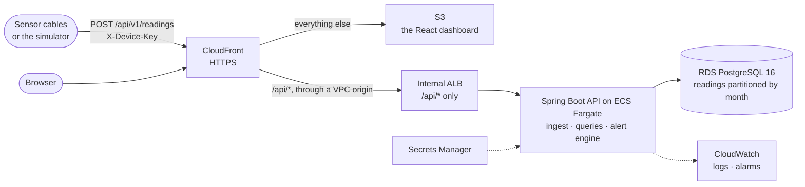

# Grain Bin Telemetry

A backend service and dashboard for monitoring stored grain.

Sensor cables hang inside grain bins and report temperature and moisture at several depths. The
service ingests those readings, stores them as time series, and raises alerts when a bin shows
signs of spoilage or a device stops reporting. A dashboard shows every bin, a grid of its
sensors, charts over time, and the open alerts.

It demonstrates production-style backend engineering end to end:
- an API with idempotent ingest that tolerates retries, reordering and clock skew
- time-series storage in PostgreSQL, partitioned by month
- an alert engine with de-duplication and auto-resolve
- integration tests against real Postgres, never a mock
- a container image, CI/CD and infrastructure as code on AWS, with no stored keys
- observability, and load testing

## Try it locally

You need **Docker**, **Python 3.11+** and **Node.js 24**. Docker runs the database, the API's
production image, Prometheus and Grafana. The simulator plays the sensors, and the dashboard runs
from Vite.

```bash
git clone https://github.com/Bacchetto/grain-bin-monitoring.git
cd grain-bin-monitoring
cp .env.example .env                           # then set ADMIN_TOKEN: the file shows how to generate one
docker compose --profile api up -d --build     # Postgres, the API on :8080, Prometheus, Grafana
```

Start the simulator, and create some bins:

```bash
python -m venv simulator/.venv
# Windows: simulator\.venv\Scripts\activate    macOS/Linux: source simulator/.venv/bin/activate
pip install -r simulator/requirements.txt
python simulator/sim.py --seed-bins 3          # 3 bins, one device each; keys saved to simulator/.devices.json
```

Open the dashboard in a second terminal, then sign in with the `ADMIN_TOKEN` from `.env`:

```bash
cd frontend && npm install && npm run dev      # http://localhost:5173
```

Then run the scenarios and watch the dashboard:

| Command | What happens |
|---|---|
| `python simulator/sim.py --scenario normal --interval 10` | Steady readings every 10 seconds, with a small daily swing near the top of each bin. The grid fills in. Ctrl-C stops it. |
| `python simulator/sim.py --scenario hotspot --bins 1` | Replays five days in about two minutes: three steady, then one sensor mid-bin warming. **`RATE_OF_RISE`** opens at the next check, within five minutes, while the sensor is still near 13 °C. |
| `python simulator/sim.py --scenario wet --bins 1` | Replays a day of rising moisture on the bottom sensors. **`HIGH_MOISTURE`** opens on every cable. |
| `python simulator/sim.py --scenario offline --bins 1` | Five samples, then silence. **`DEVICE_OFFLINE`** opens about 90 seconds later, plus up to a minute for the check. |
| `python simulator/sim.py --scenario flaky --cycles 20` | Resent batches, shuffled order and skipped intervals. No alerts, and nothing stored twice. |

Grafana is at http://localhost:3000, with ingest rate, latency and alert transitions. To stop
everything, run `docker compose --profile api down`, or add `-v` to delete the data as well.

## How it works



**Ingest is idempotent.**
- **Authentication:** a device posts batches of up to 500 samples, authenticated by its own API key. Only a SHA-256 hash of the key is stored ([ADR 0004](docs/decisions/0004-sha-256-for-device-api-keys.md)).
- **Retries are safe:** every reading carries the device's monotonically increasing `seq`, and the insert ignores a reading it already holds. A retried batch is counted as duplicates, not stored twice.
- **The response adds up:** it counts accepted, duplicate and rejected readings, and they always sum to what was sent.
- **Bad timestamps are refused one sample at a time:** a sample more than five minutes in the future, or older than 30 days, is rejected, and the rest of the batch is stored.
- **Clocks:** `last_seen_at` follows the server's clock, so a device's clock skew can't cause or hide an offline alert ([ADR 0005](docs/decisions/0005-last-seen-uses-server-clock.md)).

**Storage.**
- **Partitions:** `readings` is range-partitioned by month, and partitions are created ahead of time, so an insert never fails for want of one ([ADR 0010](docs/decisions/0010-monthly-range-partitioning.md)).
- **Indexes:** the read-path indexes were chosen with `EXPLAIN ANALYZE` on 6.2 million rows ([ADR 0007](docs/decisions/0007-read-path-indexes-verified-with-explain-analyze.md)).
- **Data access:** plain SQL through Spring JDBC, with no ORM ([ADR 0008](docs/decisions/0008-spring-jdbc-over-jpa.md)).

**Alerts.** Thresholds are set per bin, and the defaults are placeholders, not agronomic guidance.

| Alert | Raised when | Checked |
|---|---|---|
| `HIGH_TEMPERATURE` | a sensor is above the bin's limit (default 20 °C) | on ingest |
| `HIGH_MOISTURE` | a sensor is above the bin's limit (default 14.5 %) | on ingest |
| `RATE_OF_RISE` | a sensor's daily average has risen 2 °C over 72 hours ([ADR 0013](docs/decisions/0013-rate-of-rise-on-daily-averages.md)) | every 5 minutes |
| `DEVICE_OFFLINE` | a device has stored nothing for three of its reporting intervals | every minute |

- **One alert per condition:** a repeat detection updates the open alert instead of adding another.
- **No flapping:** an alert resolves itself after three clear evaluations ([ADR 0014](docs/decisions/0014-what-counts-as-an-alert-evaluation.md)).
- **Probe faults are ignored:** the values a faulty or just-powered probe reports (−127 °C, exactly 85 °C) are stored and shown, but never evaluated ([ADR 0016](docs/decisions/0016-ignore-probe-fault-values-in-alert-evaluation.md)).
- **One instance runs each check:** with several API instances, each scheduled check still runs on only one of them, by a PostgreSQL advisory lock ([ADR 0015](docs/decisions/0015-advisory-lock-for-scheduled-alert-jobs.md)).
- **Every state change is recorded:** each one is logged as structured JSON and counted as a metric.

**The dashboard** is React and TypeScript.
- **Pages:** a bin list with each bin's worst open alert, a bin page with a sensor grid and temperature and moisture charts over 24 hours, 7 days or 30 days, and an alerts view with Acknowledge.
- **The admin token is held in memory only,** never in browser storage ([ADR 0018](docs/decisions/0018-dashboard-stack-and-in-memory-token.md)).

**Observability.**
- **Metrics:** the API exposes Prometheus metrics: readings by outcome, ingest latency histograms and alert transitions.
- **Locally,** Grafana shows them on a provisioned dashboard.
- **In AWS,** logs go to CloudWatch, and alarms on the 5xx rate, CPU and database storage send email.

**Deployment** is Terraform and GitHub Actions ([`infra/terraform/README.md`](infra/terraform/README.md)).
- **One front door:** CloudFront serves the dashboard and the API over HTTPS from one address, so the load balancer stays internal and the metrics endpoint is never public.
- **No stored keys:** workflows reach AWS through GitHub OIDC.
- **Plans on pull requests:** every pull request that changes the infrastructure gets a `terraform plan` comment.
- **Deploys wait for approval:** a deploy runs only after the owner approves it.
- **No NAT gateway,** for cost.
- **No secrets in Terraform state:** the database password is managed by RDS, and the admin token is written to Secrets Manager without ever entering state.

**Stack:**
- **Backend:** Java 21, Spring Boot 4.1, PostgreSQL 16 with Flyway, JUnit and Testcontainers
- **Front end:** React, TypeScript, Vite, Recharts
- **Simulator:** Python
- **Operations:** Docker, GitHub Actions, Terraform, AWS (`ca-central-1`)
- **Monitoring:** Prometheus and Grafana, CloudWatch

The full requirements are in [docs/spec.md](docs/spec.md).

## Results

Everything below was measured. The dates, environments and methods are in
[docs/results.md](docs/results.md).

**Query plans,** on PostgreSQL 16 with 6.2 million readings across four monthly partitions:

| Query | Rows read | Time |
|---|---|---|
| Latest reading per sensor, 7-day lookback | 48,384 | 29 ms |
| Hourly buckets, 24 hours | 6,912 | 6 ms |
| Daily buckets, 30 days | 207,360 | 93 ms |
| Rate-of-rise daily averages, one bin, 72-hour window | 13,824 | 12 ms |

**An index that wasn't used was dropped.** The index first built for the latest-reading query was
never chosen by the planner, and it made inserts 70% slower (1,655 ms against 971 ms for 345,600
readings).

**Daily averages cancel the daily cycle.** The generated data swings ±1.5 °C each day near the top
of the bin. All 24 sensors came out with a rate of rise of exactly 0.000, so the swing isn't
mistaken for heating.

**The container image** is 239.6 MB, under its 250 MB target, and 100.7 MB compressed. The
project's own code is a 0.6 MB layer, so a normal code change ships under a megabyte of new image.

**The dashboard** downloads about 95 kB gzipped. The charts load only when a bin is opened, which
adds 110 kB.

**CI runs** on every pull request and push to `main`, in six jobs:
- a secret scan of the full history
- the backend's tests, against real PostgreSQL in Testcontainers
- the dashboard's lint, tests and build
- the simulator's tests
- the image build
- Terraform `fmt` and `validate`

**Load tests** with k6, locally and on AWS, are still to come
([#9](https://github.com/Bacchetto/grain-bin-monitoring/issues/9)).

## Known limitations

- **The admin token is not production-grade authentication.** It is one shared bearer token
  ([ADR 0003](docs/decisions/0003-filter-based-auth.md)), and real users and roles are enhancement
  [E10](docs/enhancements.md#e10).
- **Device keys can't be revoked.** A leaked key works until its device is removed from the
  database by hand ([E7](docs/enhancements.md#e7)). Bins and devices can't be deleted through the
  API either ([E8](docs/enhancements.md#e8)).
- **One bad reading fails its whole batch,** with a `400` that names it by path. Timestamps are
  the exception, and are rejected one sample at a time
  ([E1](docs/enhancements.md#e1)).
- **Daily buckets are UTC days,** not the site's local days ([E14](docs/enhancements.md#e14)).
- **Old readings are kept forever.** Nothing drops old partitions yet ([E9](docs/enhancements.md#e9)).
- **Reloading the dashboard asks for the token again.** That is the cost of keeping it out of
  browser storage.
- **The AWS deployment isn't kept running.** It costs about $45-60 a month while up, so it is
  destroyed between demos. Its database is single-AZ and has no final snapshot.

The rest of the possible enhancements, each with its trade-off, are in
[docs/enhancements.md](docs/enhancements.md).

## Design decisions

Each choice is recorded with its context, the alternatives and its consequences:

| ADR | Decision |
|---|---|
| [0001](docs/decisions/0001-no-foreign-keys-on-readings.md) | No foreign keys on the `readings` table |
| [0002](docs/decisions/0002-device-scoped-offline-alert-dedupe.md) | `DEVICE_OFFLINE` alerts de-duplicate per device, not per bin |
| [0003](docs/decisions/0003-filter-based-auth.md) | Servlet filters for authentication, not Spring Security |
| [0004](docs/decisions/0004-sha-256-for-device-api-keys.md) | SHA-256 for device API keys, not bcrypt |
| [0005](docs/decisions/0005-last-seen-uses-server-clock.md) | `last_seen_at` records the server's clock, not the device's |
| [0006](docs/decisions/0006-reject-samples-older-than-a-configurable-age.md) | Reject samples older than a configurable age |
| [0007](docs/decisions/0007-read-path-indexes-verified-with-explain-analyze.md) | Read-path indexes, verified with `EXPLAIN ANALYZE` |
| [0008](docs/decisions/0008-spring-jdbc-over-jpa.md) | Spring JDBC rather than JPA |
| [0009](docs/decisions/0009-spring-boot-4.md) | Spring Boot 4.1, not 3.5 |
| [0010](docs/decisions/0010-monthly-range-partitioning.md) | Range-partition `readings` by month |
| [0011](docs/decisions/0011-bin-id-denormalised-onto-readings.md) | Store `bin_id` on every reading |
| [0012](docs/decisions/0012-rancher-desktop-for-local-containers.md) | Rancher Desktop as the local container runtime |
| [0013](docs/decisions/0013-rate-of-rise-on-daily-averages.md) | Measure rate of rise on daily averages |
| [0014](docs/decisions/0014-what-counts-as-an-alert-evaluation.md) | What counts as one alert evaluation |
| [0015](docs/decisions/0015-advisory-lock-for-scheduled-alert-jobs.md) | One instance at a time for scheduled alert jobs, by advisory lock |
| [0016](docs/decisions/0016-ignore-probe-fault-values-in-alert-evaluation.md) | Keep probe fault values out of alert evaluation |
| [0017](docs/decisions/0017-cors-filter-before-authentication.md) | A CORS filter ahead of the authentication filters |
| [0018](docs/decisions/0018-dashboard-stack-and-in-memory-token.md) | Dashboard stack, and a token held in memory only |
| [0019](docs/decisions/0019-structured-json-logging.md) | Structured JSON logging, built into Spring Boot |
| [0020](docs/decisions/0020-time-scale-replays-the-past.md) | The simulator's `--time-scale` replays the past |
| [0021](docs/decisions/0021-local-tooling-on-a-network-drive.md) | Local tooling that works from a network drive: poll, don't watch; build, don't mount |

The requirements and milestones are in [docs/spec.md](docs/spec.md), and progress is tracked in
[GitHub issues](https://github.com/Bacchetto/grain-bin-monitoring/issues?q=label%3Amilestone).

## Layout

```
backend/            Spring Boot service; one package per feature: ingest, readings, alerts, bins, devices, config
  src/main/resources/db/migration/   Flyway migrations, append-only
  Dockerfile        the production image
frontend/           the React + TypeScript dashboard
simulator/          the Python device simulator and its tests
infra/bootstrap/    the Terraform state bucket, applied once
infra/terraform/    the AWS stack, with its runbook
ops/                Prometheus config and the provisioned Grafana dashboard
.github/workflows/  ci.yml, plan.yml, deploy.yml
.githooks/          the gitleaks pre-commit hook
docs/               spec, setup, results, enhancements, decision records
docker-compose.yml  local Postgres, Prometheus, Grafana, and the API image
```

## Development

```bash
cp .env.example .env                    # then set ADMIN_TOKEN
git config core.hooksPath .githooks     # secret scanning on every commit; needs gitleaks
docker compose up -d                    # Postgres :5432, Prometheus :9090, Grafana :3000
cd backend && ./mvnw spring-boot:run    # the API on :8080, configured from ../.env
cd frontend && npm install && npm run dev
pip install -r simulator/requirements-dev.txt   # in simulator/.venv

cd backend && ./mvnw verify             # unit tests, and integration tests on Testcontainers
cd frontend && npm run lint && npm run build && npm test
cd simulator && pytest
docker build -t grain-telemetry-api backend/
terraform -chdir=infra/terraform fmt -check && terraform -chdir=infra/terraform validate
```

**Notes:**
- **Port 8080:** the host-run API and the `api` Compose profile both use it, so run one or the other.
- **Docker for the backend tests:** Testcontainers needs a Docker-compatible engine. With Rancher Desktop, that means the dockerd (moby) engine ([ADR 0012](docs/decisions/0012-rancher-desktop-for-local-containers.md)).
- **Rebuild after editing `ops/`:** the Prometheus and Grafana config is built into their images, not mounted, so run `docker compose up -d --build` ([ADR 0021](docs/decisions/0021-local-tooling-on-a-network-drive.md)).

Configuration, monitoring, shorter alert checks for demos and the rest are in
[docs/setup.md](docs/setup.md).
