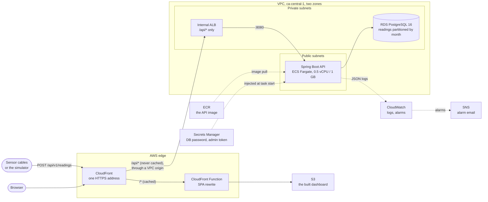
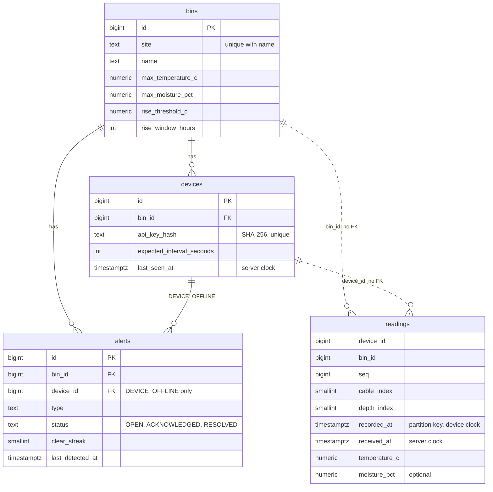

# Architecture

How Grain Bin Telemetry fits together: what runs where, what happens to one
batch of readings from the moment a device sends it until an alert shows on the
dashboard, how the data is laid out, and how the system behaves when things go
wrong. Each choice links to the decision record that explains it. The
requirements themselves are in [`spec.md`](spec.md).

## The deployed system



| Part | What it does | Why it is like this |
|---|---|---|
| **CloudFront** | The only public address. It serves the dashboard from S3, and passes `/api/*` to the load balancer | One HTTPS origin for both, so no mixed content, no CORS and no custom domain needed ([ADR 0023](decisions/0023-cloudfront-single-front-door.md)) |
| **CloudFront Function** | Rewrites extension-less paths such as `/bins/3` to `/index.html`, on the dashboard paths only | API errors keep their Problem Details instead of turning into the dashboard's HTML (ADR 0023) |
| **Internal ALB** | Forwards only `/api/*` to the API tasks. Anything else gets a fixed 404 | It has no public address, so nothing else on the API, such as `/actuator/prometheus`, is reachable from the internet (ADR 0023, enhancement E15) |
| **ECS Fargate task** | The Spring Boot API: ingest, queries, the alert engine and its scheduled checks | A public IP instead of a NAT gateway; inbound traffic only from the load balancer ([ADR 0022](decisions/0022-no-nat-gateway.md)). The image: [ADR 0025](decisions/0025-production-dockerfile.md) |
| **RDS PostgreSQL 16** | All state: bins, devices, readings and alerts | Private subnets, reachable only from the tasks. The password is managed by RDS and never seen by Terraform ([ADR 0024](decisions/0024-secrets-kept-out-of-terraform-state.md)) |
| **Secrets Manager** | The database password and the admin token, injected into the task as environment variables when it starts | Neither secret is in Terraform state (ADR 0024) |
| **CloudWatch and SNS** | The API's JSON logs ([ADR 0019](decisions/0019-structured-json-logging.md)), and email alarms on the 5xx rate, task CPU and database storage | |

**How it gets there.**
- **Terraform** describes the whole stack (`infra/terraform/`).
- **GitHub Actions** plans it on every pull request and deploys it after the owner approves, through OIDC, with no stored keys ([ADR 0026](decisions/0026-two-oidc-roles-and-an-approval-gate.md)).
- **The first apply after a destroy is always by hand** ([ADR 0027](decisions/0027-budget-first-and-a-taskless-first-apply.md)).

The runbook is in [`infra/terraform/README.md`](../infra/terraform/README.md).

**Locally**, Docker Compose runs:
- PostgreSQL;
- the API, either on the host (`./mvnw spring-boot:run`) or as the production image (`--profile api`);
- Prometheus and Grafana for the application's own metrics.

The dashboard runs from Vite. See [`setup.md`](setup.md).

## One batch, from ingest to alert

A device posts one sample: 24 readings from 4 cables at 6 depths, one of them
over the bin's temperature limit. Here is everything that happens to it.

```mermaid
sequenceDiagram
    autonumber
    participant D as Device
    participant E as CloudFront + ALB
    participant F as Auth filter
    participant S as IngestService
    participant P as PostgreSQL
    participant T as ThresholdEvaluator
    participant L as AlertLifecycle

    D->>E: POST /api/v1/readings, X-Device-Key
    E->>F: forwarded to a task
    F->>P: look up SHA-256(key) by its unique index
    P-->>F: device id, bin id
    F->>S: validated batch
    S->>S: one "now"; set aside samples out of the time window
    S->>P: ensure this month's partition (its own transaction)
    rect rgba(127, 127, 127, 0.12)
    note over S,L: one transaction
    S->>P: INSERT ... ON CONFLICT DO NOTHING, per reading
    P-->>S: 1 = stored, 0 = duplicate
    S->>P: last_seen_at = GREATEST(last_seen_at, now)
    S->>T: only the readings just stored
    T->>L: limit exceeded at cable 1, depth 3
    L->>P: upsert the open alert, RETURNING (xmax = 0)
    end
    L-->>L: after commit: JSON log line and metric
    S-->>D: 202 {"accepted": 24, "duplicates": 0, "rejected": 0}
```

1. **To a task.** The device sends the batch over HTTPS to CloudFront, which
   forwards `/api/*` uncached, with every header, through the VPC origin to the
   internal load balancer. That passes it to a healthy task on port 8080.
2. **Who is it?** `DeviceAuthFilter` covers exactly `/api/v1/readings`. It
   hashes the `X-Device-Key` header with SHA-256 and looks the digest up by its
   unique index. A match gives the device and its bin; anything else is a 401.
   The device never says who it is in the body. Plain servlet filters, not
   Spring Security ([ADR 0003](decisions/0003-filter-based-auth.md)). SHA-256,
   not bcrypt, because keys are random and long, and the lookup is on every
   request ([ADR 0004](decisions/0004-sha-256-for-device-api-keys.md)).
3. **Is it well formed?** Bean Validation checks the body. More than 500
   samples is a 413, and a structurally invalid reading fails the whole batch
   with a 400 that names it by path, such as `samples[3].sensors[0].temperatureC`.
4. **Is it in the time window?** `IngestService` takes one instant from the
   clock, and every time decision in the request uses it. Samples more than 5
   minutes in the future, or older than 30 days, are set aside and counted as
   rejected; the rest continue
   ([ADR 0006](decisions/0006-reject-samples-older-than-a-configurable-age.md)).
5. **Is there a partition?** Each month's readings live in their own partition
   ([ADR 0010](decisions/0010-monthly-range-partitioning.md)). A daily job
   creates the current month and the next three ahead of time. Ingest also
   checks, and creates a missing month in its own short transaction, *before*
   the write. A batch that later rolls back can't take the new partition with
   it, so an insert never fails for want of one.
6. **Store it, exactly once.** In one transaction, every reading is inserted
   with `ON CONFLICT DO NOTHING`. The primary key is
   `(device_id, seq, cable_index, depth_index, recorded_at)`, with `recorded_at`
   included because Postgres requires a partitioned table's unique keys to
   contain the partition key. Each row's update count says what happened: 1 is
   stored, 0 is a duplicate. That makes a retried batch harmless. The readings
   carry `bin_id`, so dashboard queries need no join
   ([ADR 0011](decisions/0011-bin-id-denormalised-onto-readings.md)), and have
   no foreign keys ([ADR 0001](decisions/0001-no-foreign-keys-on-readings.md)).
7. **The device was seen.** If anything was stored, `last_seen_at` moves to the
   *server's* time, never backwards, so a device's clock can't cause or hide an
   offline alert ([ADR 0005](decisions/0005-last-seen-uses-server-clock.md)).
8. **Judge the thresholds.** Still in the same transaction, `ThresholdEvaluator`
   judges only the readings just stored, so a resent duplicate evaluates
   nothing. It takes each sensor's newest reading in the batch, and skips a
   batch that is older than what is already stored. It ignores probe fault
   values: exactly 85.0 °C, or anything outside -60..100 °C
   ([ADR 0014](decisions/0014-what-counts-as-an-alert-evaluation.md),
   [ADR 0016](decisions/0016-ignore-probe-fault-values-in-alert-evaluation.md)).
   A healthy bin costs three small indexed reads and no writes.
9. **Open the alert.** `AlertLifecycle` upserts the alert against a partial
   unique index: one non-resolved alert per bin, type and sensor position, or
   per device for `DEVICE_OFFLINE`
   ([ADR 0002](decisions/0002-device-scoped-offline-alert-dedupe.md)).
   `RETURNING (xmax = 0)` says whether the row was inserted, which is a new
   alert, or updated, which is a repeat detection that only moves
   `last_detected_at`. The alert and the reading that caused it commit together
   or not at all.
10. **Tell someone, after commit.** `AlertTransitions` defers the report until
    the transaction commits, so a rolled-back batch never logs or counts an
    alert that doesn't exist. The report is a structured JSON log line and
    `alerts_transitions_total{type,to_state}`. Ingest counts its outcomes
    (`ingest_readings_total{outcome}`) and records its latency in the same way.
11. **Answer.** `202 Accepted`, with the three counts in readings. They always
    add up to the number of readings sent.

**Then, on a schedule:**
- **Rate of rise:** every 5 minutes, the API compares each sensor's average
  over the last 24 hours with its average for the 24 hours that ended 72
  hours ago. Daily averages, so the day-night swing near the top of a bin isn't
  mistaken for heating ([ADR 0013](decisions/0013-rate-of-rise-on-daily-averages.md)).
- **Offline:** every minute, any device that has stored nothing for three of its
  reporting intervals goes offline.
- **One instance at a time:** each check runs in a transaction that first takes
  a PostgreSQL advisory lock, so with several tasks, each check still runs on
  only one of them ([ADR 0015](decisions/0015-advisory-lock-for-scheduled-alert-jobs.md)).
  The checks are scheduled with a fixed delay, so a slow run pushes the next
  one back rather than overlapping it.
- **Auto-resolve:** an open alert that reads clear for three evaluations in a
  row resolves itself. Each clear increments a streak, and any detection resets
  it, so an alert near its threshold doesn't flap.

**On the dashboard.**
- **Loading it:** the browser loads the dashboard from CloudFront. The SPA
  function serves `index.html` for a deep link such as `/bins/1`.
- **Signing in:** it asks for the admin token, checks it by listing bins, and
  keeps it in memory only, never in browser storage
  ([ADR 0018](decisions/0018-dashboard-stack-and-in-memory-token.md)).
- **Calling the API:** it calls `/api/v1` on its own address, with
  `Authorization: Bearer`. `AdminAuthFilter` covers the rest of `/api/v1`. A
  CORS filter runs ahead of both auth filters, for local development
  ([ADR 0017](decisions/0017-cors-filter-before-authentication.md)).
- **What shows:** the bin list shows the new alert as the bin's worst, at its
  next 30-second refresh. The alerts view lists it with an Acknowledge button.

## The data



- **`readings` is range-partitioned by `recorded_at`, one partition per month.**
  Queries for a time range touch only the months they cover, and old data can
  one day be dropped a month at a time (enhancement E9).
- **Indexes match the queries:** the primary key for idempotency, and
  `(bin_id, recorded_at)` for every read path, the dashboard's queries and the
  rate-of-rise windows alike. They were verified with `EXPLAIN ANALYZE` on 6.2
  million readings. An index that the planner never used was dropped, because
  it made inserts 70% slower
  ([ADR 0007](decisions/0007-read-path-indexes-verified-with-explain-analyze.md)).
- **Access is plain SQL** through Spring JDBC's `JdbcClient`, with no ORM
  ([ADR 0008](decisions/0008-spring-jdbc-over-jpa.md)). **Flyway migrations
  are append-only**, and the app refuses to start if an applied one has been
  edited.

## When things go wrong

| Situation | What happens |
|---|---|
| **A device resends a batch,** after a timeout or a retry | Every reading conflicts on the primary key and is counted as a duplicate. Nothing is stored twice, no alert is evaluated, and `last_seen_at` doesn't move. Load-tested: 150,503 resends, all caught, and 69.5 million unique readings each stored exactly once |
| **The response is lost,** so the server stored the batch but the device never heard | The device retries, and the retry comes back as duplicates. The load test hit this case 3 times, and each batch was stored exactly once |
| **Batches arrive out of order** | Each reading is stored under its own `recorded_at`, so order of arrival doesn't matter. A batch older than what is stored doesn't drive threshold alerts |
| **The device's clock is wrong** | Samples more than 5 minutes in the future, or over 30 days old, are rejected and counted. `last_seen_at` uses the server's clock, so skew can't fake liveness |
| **A month's partition is missing** | Ingest creates it first, in its own transaction. A daily job also keeps three months ahead |
| **A device goes quiet** | After three of its reporting intervals with nothing stored, the offline check opens `DEVICE_OFFLINE` for that device. A device that connects but sends only duplicates or rejected data is just as offline |
| **A batch fails halfway** | Its transaction rolls back: no readings, no `last_seen_at`, no alert, and no log line or metric for an alert that never existed |
| **Two or more API tasks** | Ingest is safe on any number of them: the database decides duplicates. Each scheduled check runs on one task at a time, through the advisory lock |
| **The API is overloaded** | Requests queue. Latency climbs, but nothing fails and nothing is miscounted. One 0.5 vCPU task tops out at about 485 requests a second (11,000 readings a second); see [`results.md`](results.md) |
| **The database is down** | Requests fail with 5xx, and nothing is half-stored. The load balancer's 5xx alarm emails the owner |

## What is deliberately not here

| Not here | Why | Where it's recorded |
|---|---|---|
| A NAT gateway, and private subnets for the tasks | About $70 a month, more than the rest of the stack. Inbound, the tasks are as closed as private ones | [ADR 0022](decisions/0022-no-nat-gateway.md) |
| Production-grade authentication | One shared admin token, held in memory by the dashboard | [ADR 0003](decisions/0003-filter-based-auth.md), enhancement E10 |
| Revoking a device key, or deleting bins and devices | Not built yet | Enhancements E7 and E8 |
| Retention | Partitions are kept forever, for now | Enhancement E9 |
| A queue in front of ingest | Ingest writes synchronously; an SQS buffer is a stretch goal | [`spec.md`](spec.md#milestones), issue #15 |
| The application's own metrics in AWS | Nothing scrapes `/actuator/prometheus` there yet. CloudWatch has the load balancer's, ECS's and RDS's metrics | Enhancement E15 |
| High availability for the database | Single-AZ RDS, with no final snapshot on destroy: a demo, destroyed between showings | `infra/terraform/rds.tf` |
| A rate-of-rise check for tens of thousands of bins | It judges bins one by one, and its cost is linear in the bins | Enhancement E17 |
